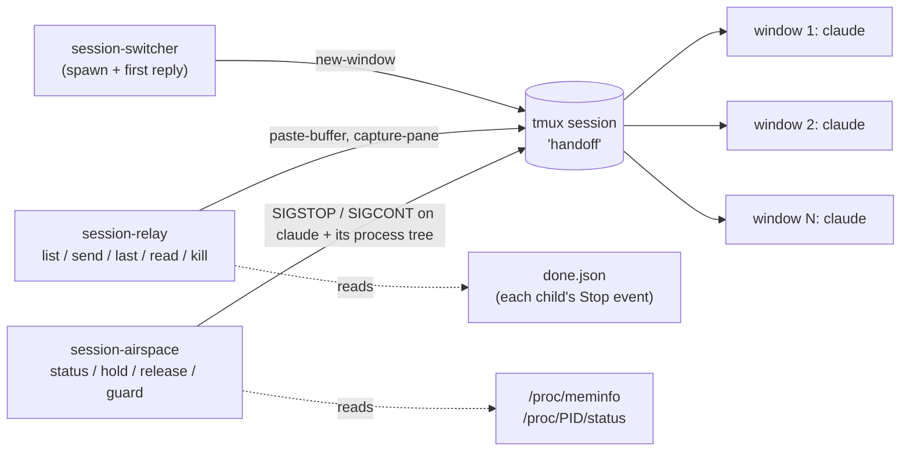

# session-stickler

**Hand work from one Claude Code session to a fresh one, get its reply back, and keep a fleet of background sessions steerable and inside your RAM budget. Built from `claude`, `tmux`, and a shell.**

> The repository is **session-stickler**. Its handoff command keeps the name `session-switcher`, alongside `session-relay` and `session-airspace`.


---

## Why this exists

Once you run several Claude Code sessions in parallel, the friction moves from the model to the plumbing around it:

- **Handing off is manual.** You open a terminal, `cd`, start `claude`, and paste a prompt. Then you check back to see whether it answered.
- **Background sessions are opaque.** From Claude Desktop (WSL backend) stdin is not a TTY, so `tmux attach` is not an option.
- **Parallel agents run out of memory.** Several Node-based CLI agents on a capped WSL2 VM can trigger the kernel OOM killer and lose hours of context.

This repo answers each problem with a small, readable Bash tool. There is no daemon, no MCP server, and no UI. Each tool is also packaged as a **Claude Code skill**, so the agent can run it on its own.

```console
$ session-switcher examples/brief.md
launched  window=sw-Xa91Qd (handoff:1.0)  workdir=/home/me/project  dir=/run/user/1000/switch.Xa91Qd
watch:    session-relay read sw-Xa91Qd   (in a terminal: tmux attach -t handoff)
accepted trust dialog for /home/me/project
child session: <child-session-uuid>
transcript:    /home/me/.claude/projects/<slug>/<child-session-uuid>.jsonl
--- child's last message ---
PONG
--- follow up: session-relay send sw-Xa91Qd --wait "<prompt>"   close: session-relay kill sw-Xa91Qd

$ session-relay send sw-Xa91Qd --wait "Now run the tests and summarise failures"
sent to handoff:1 (sw-Xa91Qd): Now run the tests and summarise failures
--- reply from handoff:1 ---
<the child's reply>
```

*The shape of the output follows the script's `echo` and `print` lines. IDs and paths are placeholders. The trust-dialog line appears only when the child opens a folder it has never seen.*

## The toolkit

| Tool | Purpose | Interface |
|---|---|---|
| [`bin/session-switcher`](bin/session-switcher) | Start a new Claude Code session in tmux with a brief, wait for its first turn, and print the reply | `session-switcher <brief.md> [workdir]`<br>env: `CLAUDE_FLAGS`, `SWITCH_TIMEOUT` (90s), `SWITCH_SESSION` (`handoff`), `SWITCH_RAM_WARN` (85) |
| [`bin/session-relay`](bin/session-relay) | See and steer child sessions without a TTY or `tmux attach` | `list` · `send <target> [--wait[=SECS]] "<prompt>"` · `last <target>` · `read <target> [lines=25]` · `kill <target>` |
| [`bin/session-airspace`](bin/session-airspace) | Hold the largest children under memory pressure and release them when memory frees up | `status` · `hold <target>` · `release <target>` · `guard [--threshold 85] [--interval 5] [--once]` |

A `<target>` is the window name `session-switcher` prints (`sw-Xa91Qd`), a `session:index` from `session-relay list`, or a bare window index in `$SWITCH_SESSION`. `session-relay` and `session-airspace` find children in **every** tmux session by their return channel (`claude --settings <dir>/settings.json`), so children of big-next-job's `run-job` (`job-*` sessions) show up next to handoffs. Nothing else on the machine can be targeted: a typo or a stray PID is refused.

## How it works

### The handoff protocol

`session-switcher` copies the mechanism of Orca's `worktree create --agent claude --prompt`. The brief travels as **one shell argument**. The child's identity travels in **environment variables**. The reply comes back through Claude's **`Stop` hook**.

```mermaid
sequenceDiagram
    autonumber
    participant P as Parent Claude session
    participant S as session-switcher
    participant T as tmux session handoff
    participant C as Child claude
    participant F as Rendezvous dir (0700)

    P->>S: session-switcher brief.md [workdir]
    S->>S: validate tools, brief non-empty, first byte not '-'
    S->>F: write settings.json with Stop hook "cat > done.json"
    S->>T: create session if absent, with CLAUDE* vars unset
    S->>T: new-window -e SWITCH_ID / SWITCH_DIR / SWITCH_PARENT
    T->>C: sh -c "claude $CLAUDE_FLAGS --settings settings.json 'brief'; :"
    loop every 1s until done.json or SWITCH_TIMEOUT
        S->>T: capture-pane, look for trust dialog
        opt workdir is the parent's own $PWD
            S->>C: send-keys Down Enter
        end
    end
    C->>F: Stop event JSON piped to done.json
    S->>P: session_id, transcript_path, last_assistant_message
```

Step by step:

1. **Private rendezvous directory.** `mktemp -d` under `$XDG_RUNTIME_DIR` (falling back to `/tmp`) creates a mode `0700` directory. Its basename becomes `SWITCH_ID`.
2. **Return channel.** A generated `settings.json` registers a `Stop` hook that pipes the event JSON into `done.json`. The child is started with `--settings`, so the user's own config is left untouched.
3. **Brief as a single argv.** The file is POSIX single-quoted (`'` becomes `'\''`). Quotes, `$VARS`, backticks, `;` and newlines therefore reach `claude` literally, as one argument.
4. **Clean child environment.** When the script creates the tmux session, it unsets every `CLAUDE*` variable first, so the child does not think it is nested. It receives `SWITCH_ID`, `SWITCH_DIR` and `SWITCH_PARENT` (the parent's `CLAUDE_CODE_SESSION_ID`, or `$PPID` as a fallback).
5. **A shell stays between tmux and `claude`.** The window runs `claude ...; :`. The trailing `:` stops the shell from `exec`-ing `claude`, so `claude` is the shell's child, not the pane's own process. That matters for holds: tmux sends `SIGCONT` to any pane process that stops (`server_child_stopped` in tmux's `server.c`), which silently undid every `SIGSTOP` before this change. The window is named `sw-<id>`, so it keeps one stable name while other windows open and close.
6. **Bounded wait.** The script polls once per second for up to `SWITCH_TIMEOUT` seconds, then parses `done.json` with `python3`. The child stays alive in its tmux window afterwards; continue the conversation with `session-relay send sw-<id> --wait "..."`. Before launching, it warns when RAM use is already at `SWITCH_RAM_WARN` percent or more.

**Exit codes:** `0` means the reply was printed. `1` means a precondition failed (missing `claude`/`tmux`, or a bad brief). `2` means the wait timed out; the child is still running.

### Operating the fleet



- **`session-relay`** reads each child's `done.json`, the same `Stop` event `session-switcher` waits on. `list` shows one line per child: target, state (`starting`, `working`, `idle`, `held`), memory, age, time since its last activity, and its last reply. `send` pastes the prompt with `tmux paste-buffer -p` (bracketed paste) and then presses Enter, so a multi-line prompt arrives as one message and words like `Enter` or `C-c` arrive as text. `--wait` blocks until the child's next `Stop` event and prints the reply; it exits `2` on timeout. `last` prints the latest full reply, `read` the pane including scrollback, and `kill` closes the window, resumes a held child first, and waits for `claude` to exit.
- **`session-airspace`** uses the airspace metaphor. A child whose `claude` is in state `T` is **HOLDING**; anything else is **FLYING**. `hold` stops `claude` and every process under it (Bash-tool commands, MCP servers), parents first; `release` resumes them, children first. `guard` gets system RAM from `MemTotal − MemAvailable`. At or above the threshold, it holds the flying child with the largest total RSS, but always leaves one child flying so the fleet keeps moving. At 10 points or more below the threshold, it releases one child it held itself; a hold you placed by hand stays until you release it. However it stops (`Ctrl-C`, `SIGTERM`, a hangup or an error), it releases its own holds; only `SIGKILL` can strand one. It takes at most one action per tick, and the 10-point gap keeps it from flapping. Children launched before the wrapped-launch change cannot be held; `status` marks them `not holdable`.

## Engineering highlights

- **Input is checked before anything starts.** `session-switcher` refuses a brief that is missing or empty, or whose first byte is `-`. Such a brief would reach `claude` as a flag rather than a prompt. It also confirms that `claude` and `tmux` are on `PATH` before creating any state.
- **Quoting is tested, not assumed.** A brief that contains `It's`, `"…"`, `$HOME`, `` `cmd` ``, `; rm -rf x` and several lines arrives as exactly one argument (`argc = 1`), with its content unchanged.
- **Trust dialog: auto-answered only for the parent's own folder.** Claude asks for confirmation before working in an unseen folder. The script answers that dialog by screen-scraping the pane, the same trick Orca's daemon uses, **only when `workdir` equals the parent's `$PWD`**. A folder the parent is already working in is implicitly trusted. Any other folder times out with exit `2`, and a human answers by hand. A source comment marks the scrape for removal if `claude` gains a `--trust` flag.
- **Hooks instead of polling the screen for results.** The reply is the structured `Stop` event (`session_id`, `transcript_path`, `last_assistant_message`). It is not scraped terminal text.
- **No daemon, no extra services.** Three Bash scripts in `set -euo pipefail` plus a small shared helper (`lib/`). They need `python3` only for JSON and `/proc` parsing, and keep all state in tmux plus one temp directory per handoff (and one file listing the guard's own holds).
- **Holds are tested on real sessions, not assumed.** A live `claude` child was held for 90 seconds in the middle of a streaming reply, and for 40 seconds during a foreground Bash-tool command (the command's own `sleep` was held too). Both turns completed normally after release, with no error or retry; the API connection survived the pause. `tests/smoke.sh` covers the rest of the behaviour with a fake `claude`: 36 checks, no account needed.
- **Desktop-aware.** `session-relay` exists because a parent hosted by Claude Desktop has no TTY. The design notes record the evidence: `tty` reports `not a tty`, and `CLAUDE_CODE_DESKTOP_APP_VERSION` is set.
- **Skills-first.** Each tool has a `SKILL.md` that tells Claude when and how to call it, so "hand this off" becomes something the agent does by itself.

## Requirements

- Linux or WSL2. `session-airspace` reads `/proc`.
- `bash`, `tmux`, `python3`
- [Claude Code](https://docs.anthropic.com/en/docs/claude-code) CLI (`claude`) on `PATH`, signed in

## Install

```bash
git clone https://github.com/z0rd0n88/session-stickler ~/session-stickler
export PATH="$HOME/session-stickler/bin:$PATH"       # add to your shell rc

# Optional: let Claude Code discover the skills
mkdir -p ~/.claude/skills
for s in session-switcher session-relay session-airspace; do
  ln -s ~/session-stickler/skills/$s ~/.claude/skills/$s
done
```

## Usage

**Hand off a task**

```bash
cat > handoff.md <<'EOF'
# Fix flaky test
Run pytest in tests/api, find the flaky test, fix it, and summarise the root cause.
EOF
CLAUDE_FLAGS="--dangerously-skip-permissions" SWITCH_TIMEOUT=300 session-switcher handoff.md
```

Write the brief so it stands alone, because the child shares no context with the parent. Start it with a heading, not a `-`. Use `CLAUDE_FLAGS` only when the child must use tools unattended. Close one child with `session-relay kill sw-<id>`, or everything with `tmux kill-session -t handoff`.

**Steer background sessions (works from Claude Desktop)**

```bash
session-relay list                                   # every child: state, memory, last reply
session-relay send sw-Xa91Qd --wait "Run pytest and summarize failures"   # prints the reply
session-relay send sw-Xa91Qd -f followup.md          # prompt from a file (or - for stdin)
session-relay last sw-Xa91Qd                         # the latest full reply
session-relay read sw-Xa91Qd 40                      # last 40 lines of its screen
session-relay kill sw-Xa91Qd
```

A child can end its turn while a command it started keeps running in the background ("waiting for the command to finish"). `--wait` returns at that turn's end; use `last` later for the follow-up reply.

**Keep the fleet within memory**

```bash
session-airspace status            # system RAM + each child FLYING/HOLDING and its memory
session-airspace hold sw-Xa91Qd    # SIGSTOP claude and everything under it
session-airspace release sw-Xa91Qd # SIGCONT
session-airspace guard --threshold 85 --interval 5   # watch continuously: 85%, check every 5s
session-airspace guard 85 5                          # same, positional form
session-airspace guard --threshold 90 --once         # a single check at 90%, then exit
```

## Testing

```bash
tests/smoke.sh      # 36 checks; prints "36 passed, 0 failed"
```

It runs in a private tmux server with a fake `claude` (`tests/fake-bin/claude`), so it needs only `tmux` and `python3` and leaves your real sessions alone. It covers the handoff, every relay command (including multi-line prompts and key names sent as text), holds across a process tree, the guard's hold/release rules, and refusing a target that is not a managed child.

## Skills

| Skill | Triggers on | Teaches Claude to |
|---|---|---|
| [`session-switcher`](skills/session-switcher/SKILL.md) | "hand this off", "start a new session with this", "switch sessions" | write a self-contained brief, launch, and pass the child's reply on to the user |
| [`session-relay`](skills/session-relay/SKILL.md) | checking on or following up with a handed-off session, including from Claude Desktop | list children, send a follow-up and wait for the reply, read, close |
| [`session-airspace`](skills/session-airspace/SKILL.md) | high RAM with parallel sessions, or "pause / resume that session" | inspect states, hold, release, or run the guard |

## Security considerations

These trade-offs are deliberate and documented in the code and skills:

- **The brief is visible in argv.** Any process running as the same user can read it from `/proc/<pid>/cmdline`. That is acceptable on a single-user machine. For secrets, put a *file path* in the brief, not the secret itself.
- **`--dangerously-skip-permissions` is opt-in.** You enable it only through `CLAUDE_FLAGS`; it is never on by default.
- **The trust dialog is auto-accepted for one folder only**, the parent's own working directory. Every other folder still needs a human.
- **Handoff state is private.** The rendezvous directory is created by `mktemp -d` (mode `0700`) under `$XDG_RUNTIME_DIR` when that is set.
- **`SIGSTOP` has limits.** A held session keeps any git lock or file it holds open until it is released. A held process also keeps its memory: holding stops new allocation and CPU use but frees no RAM (the kernel can swap it out). An open API connection survived 90 seconds held in testing; much longer holds are untested.
- **`session-relay send` writes into the pane as if you typed it**, so only send prompts you would type yourself. It refuses a held child, since nothing would read the prompt, and a child showing a dialog (exit `5`), since its Enter would pick the dialog's highlighted option: on a permission prompt, "Yes". Detection reads the dialog's `Esc to cancel` footer from the screen, so a Claude Code UI change could break it.

## Repository layout

```text
session-stickler/
├── bin/
│   ├── session-switcher      # spawn a child session, return its first reply
│   ├── session-relay         # list / send / read / kill tmux-hosted sessions
│   └── session-airspace      # RAM monitor + SIGSTOP/SIGCONT holding patterns
├── lib/
│   ├── session_panes.py      # finds Claude children in tmux, process trees, RAM, done.json
│   └── session-common.sh     # target resolution and hold/release, shared by relay and airspace
├── tests/
│   ├── smoke.sh              # 36 checks across all three tools (tmux + python3, no account)
│   └── fake-bin/claude       # stand-in claude that answers "echo: <prompt>" and fires the Stop hook
├── skills/
│   ├── session-switcher/SKILL.md
│   ├── session-relay/SKILL.md
│   └── session-airspace/SKILL.md
├── docs/ideas/
│   ├── session-board.md              # design handoff: board, child inbox, native --bg spike
│   └── session-management-nebula.md  # ranked idea exploration behind airspace and relay
└── examples/
    └── brief.md              # smoke-test brief: expects the reply "PONG"
```

## Roadmap (designed, not built)

[`docs/ideas/session-board.md`](docs/ideas/session-board.md) plans the next step. A short spike will test whether Claude Code's native `--bg` background sessions can replace the tmux layer. Then comes a one-line-per-session board (`session-relay list` is a first version of it), and a child-to-parent inbox written by the `Stop` hook, which removes the blocking wait. [`docs/ideas/session-management-nebula.md`](docs/ideas/session-management-nebula.md) ranks further candidates, led by `session-worktree`, which would give each child its own git worktree. `session-airspace` and `session-relay` came out of the same exploration.

## Credits and license

Written by [@z0rd0n88](https://github.com/z0rd0n88). The handoff mechanism is adapted from Orca's `worktree create --agent claude --prompt`.

There is no license file yet, so default copyright applies. Open an issue if you want to reuse the code.
