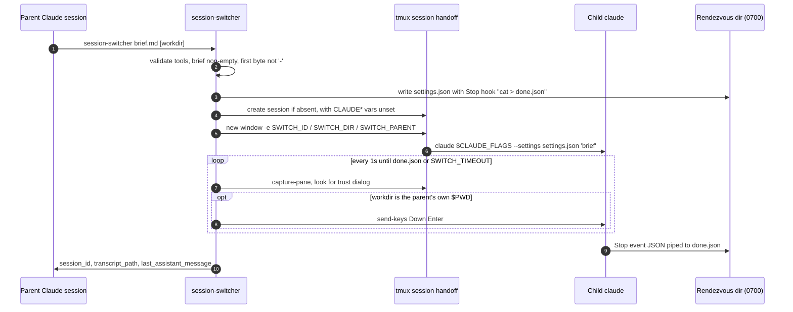
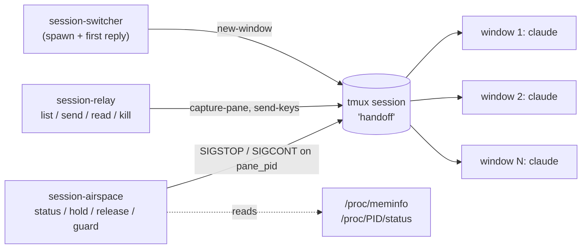

# session-stickler

**Hand work from one Claude Code session to a fresh one, get its reply back, and keep a fleet of background sessions steerable and inside your RAM budget. Built from `claude`, `tmux`, and a shell.**

> The repository is **session-stickler**. Its handoff command keeps the name `session-switcher`, alongside `session-relay` and `session-airspace`.


---

## Why this exists

Once you run several Claude Code sessions in parallel, the friction moves from the model to the plumbing around it:

- **Handing off is manual.** You open a terminal, `cd`, start `claude`, and paste a prompt. Then you check back to see whether it answered.
- **Background sessions are opaque.** From Claude Desktop (WSL backend) stdin is not a TTY, so `tmux attach` is not an option.
- **Parallel agents run out of memory.** Several Node-based CLI agents on a capped WSL2 VM can trigger the kernel OOM killer and lose hours of context.

This repo answers each problem with a small, readable Bash tool. There is no daemon, no MCP server, and no UI. Each tool is also packaged as a **Claude Code skill**, so the agent can run it on its own.

```console
$ session-switcher examples/brief.md
launched  window=handoff:1.0  workdir=/home/me/project  dir=/run/user/1000/switch.Xa91Qd
watch:    tmux attach -t handoff
accepted trust dialog for /home/me/project
child session: <child-session-uuid>
transcript:    /home/me/.claude/projects/<slug>/<child-session-uuid>.jsonl
--- child's last message ---
PONG
```

*The shape of the output follows the script's `echo` and `print` lines. IDs and paths are placeholders. The trust-dialog line appears only when the child opens a folder it has never seen.*

## The toolkit

| Tool | Purpose | Interface |
|---|---|---|
| [`bin/session-switcher`](bin/session-switcher) | Start a new Claude Code session in tmux with a brief, wait for its first turn, and print the reply | `session-switcher <brief.md> [workdir]`<br>env: `CLAUDE_FLAGS`, `SWITCH_TIMEOUT` (90s), `SWITCH_SESSION` (`handoff`) |
| [`bin/session-relay`](bin/session-relay) | Inspect and steer background sessions without a TTY or `tmux attach` | `list` · `send <window> "<prompt>"` · `read <window> [lines=25]` · `kill <window>` |
| [`bin/session-airspace`](bin/session-airspace) | Pause the largest sessions under memory pressure and resume them when memory frees up | `status` · `hold <pid\|window>` · `release <pid\|window>` · `guard [threshold=85] [interval=5]` · `guard --once` |

All three tools work on the same tmux session (`$SWITCH_SESSION`, default `handoff`). That shared session is how they cooperate.

## How it works

### The handoff protocol

`session-switcher` copies the mechanism of Orca's `worktree create --agent claude --prompt`. The brief travels as **one shell argument**. The child's identity travels in **environment variables**. The reply comes back through Claude's **`Stop` hook**.



Step by step:

1. **Private rendezvous directory.** `mktemp -d` under `$XDG_RUNTIME_DIR` (falling back to `/tmp`) creates a mode `0700` directory. Its basename becomes `SWITCH_ID`.
2. **Return channel.** A generated `settings.json` registers a `Stop` hook that pipes the event JSON into `done.json`. The child is started with `--settings`, so the user's own config is left untouched.
3. **Brief as a single argv.** The file is POSIX single-quoted (`'` becomes `'\''`). Quotes, `$VARS`, backticks, `;` and newlines therefore reach `claude` literally, as one argument.
4. **Clean child environment.** When the script creates the tmux session, it unsets every `CLAUDE*` variable first, so the child does not think it is nested. It receives `SWITCH_ID`, `SWITCH_DIR` and `SWITCH_PARENT` (the parent's `CLAUDE_CODE_SESSION_ID`, or `$PPID` as a fallback).
5. **Bounded wait.** The script polls once per second for up to `SWITCH_TIMEOUT` seconds, then parses `done.json` with `python3`. The child stays alive in its tmux window afterwards, so you can continue the conversation.

**Exit codes:** `0` means the reply was printed. `1` means a precondition failed (missing `claude`/`tmux`, or a bad brief). `2` means the wait timed out; the child is still running.

### Operating the fleet



- **`session-relay`** takes a window index or name. It types prompts into a pane with `tmux send-keys` and reads output with `tmux capture-pane`. `list` shows the last non-blank line of each pane as a 60-character preview.
- **`session-airspace`** uses the airspace metaphor. A process in state `T` is **HOLDING**; anything else is **FLYING**. `guard` gets system RAM from `MemTotal − MemAvailable`. At or above the threshold, it `SIGSTOP`s the FLYING window with the highest RSS. At 10 points or more below the threshold, it `SIGCONT`s one HOLDING window. It takes at most one action per tick, and the 10-point gap keeps it from flapping between hold and release.

## Engineering highlights

- **Input is checked before anything starts.** `session-switcher` refuses a brief that is missing or empty, or whose first byte is `-`. Such a brief would reach `claude` as a flag rather than a prompt. It also confirms that `claude` and `tmux` are on `PATH` before creating any state.
- **Quoting is tested, not assumed.** A brief that contains `It's`, `"…"`, `$HOME`, `` `cmd` ``, `; rm -rf x` and several lines arrives as exactly one argument (`argc = 1`), with its content unchanged.
- **Trust dialog: auto-answered only for the parent's own folder.** Claude asks for confirmation before working in an unseen folder. The script answers that dialog by screen-scraping the pane, the same trick Orca's daemon uses, **only when `workdir` equals the parent's `$PWD`**. A folder the parent is already working in is implicitly trusted. Any other folder times out with exit `2`, and a human answers by hand. A source comment marks the scrape for removal if `claude` gains a `--trust` flag.
- **Hooks instead of polling the screen for results.** The reply is the structured `Stop` event (`session_id`, `transcript_path`, `last_assistant_message`). It is not scraped terminal text.
- **No daemon, no extra services.** Three Bash scripts in `set -euo pipefail`. They need `python3` only for JSON and `/proc` parsing, and keep all state in tmux plus one temp directory per handoff.
- **Desktop-aware.** `session-relay` exists because a parent hosted by Claude Desktop has no TTY. The design notes record the evidence: `tty` reports `not a tty`, and `CLAUDE_CODE_DESKTOP_APP_VERSION` is set.
- **Skills-first.** Each tool has a `SKILL.md` that tells Claude when and how to call it, so "hand this off" becomes something the agent does by itself.

## Requirements

- Linux or WSL2. `session-airspace` reads `/proc`.
- `bash`, `tmux`, `python3`
- [Claude Code](https://docs.anthropic.com/en/docs/claude-code) CLI (`claude`) on `PATH`, signed in

## Install

```bash
git clone https://github.com/z0rd0n88/session-stickler ~/session-stickler
export PATH="$HOME/session-stickler/bin:$PATH"       # add to your shell rc

# Optional: let Claude Code discover the skills
mkdir -p ~/.claude/skills
for s in session-switcher session-relay session-airspace; do
  ln -s ~/session-stickler/skills/$s ~/.claude/skills/$s
done
```

## Usage

**Hand off a task**

```bash
cat > handoff.md <<'EOF'
# Fix flaky test
Run pytest in tests/api, find the flaky test, fix it, and summarise the root cause.
EOF
CLAUDE_FLAGS="--dangerously-skip-permissions" SWITCH_TIMEOUT=300 session-switcher handoff.md
```

Write the brief so it stands alone, because the child shares no context with the parent. Start it with a heading, not a `-`. Use `CLAUDE_FLAGS` only when the child must use tools unattended. Close everything with `tmux kill-session -t handoff`.

**Steer background sessions (works from Claude Desktop)**

```bash
session-relay list                                   # windows + last-line preview
session-relay send 1 "Run pytest and summarize failures"
session-relay read 1 40                              # last 40 lines of window 1
session-relay kill 1
```

**Keep the fleet within memory**

```bash
session-airspace status            # system RAM + per-window FLYING/HOLDING and RSS
session-airspace hold 2            # SIGSTOP window 2 (or pass a PID)
session-airspace release 2         # SIGCONT
session-airspace guard 85 5        # watch continuously: threshold 85%, check every 5s
session-airspace guard --once      # a single check at the default 85% threshold
```

## Skills

| Skill | Triggers on | Teaches Claude to |
|---|---|---|
| [`session-switcher`](skills/session-switcher/SKILL.md) | "hand this off", "start a new session with this", "switch sessions" | write a self-contained brief, launch, and pass the child's reply on to the user |
| [`session-relay`](skills/session-relay/SKILL.md) | managing background sessions without `tmux attach` | list, prompt, read and close windows headless |
| [`session-airspace`](skills/session-airspace/SKILL.md) | memory pressure across parallel sessions | inspect states, hold, release, or run the guard |

## Security considerations

These trade-offs are deliberate and documented in the code and skills:

- **The brief is visible in argv.** Any process running as the same user can read it from `/proc/<pid>/cmdline`. That is acceptable on a single-user machine. For secrets, put a *file path* in the brief, not the secret itself.
- **`--dangerously-skip-permissions` is opt-in.** You enable it only through `CLAUDE_FLAGS`; it is never on by default.
- **The trust dialog is auto-accepted for one folder only**, the parent's own working directory. Every other folder still needs a human.
- **Handoff state is private.** The rendezvous directory is created by `mktemp -d` (mode `0700`) under `$XDG_RUNTIME_DIR` when that is set.
- **`SIGSTOP` has limits.** It signals the pane's process, not its whole process tree. A frozen session can still hold a git lock or an open network connection; the design notes flag this risk. A held process keeps its memory: holding stops new allocation and CPU use but frees no RAM.
- **`session-relay send` types keystrokes.** It writes text into the pane as if a person typed it, so only send prompts you would type yourself.

## Repository layout

```text
session-stickler/
├── bin/
│   ├── session-switcher      # spawn a child session, return its first reply
│   ├── session-relay         # list / send / read / kill tmux-hosted sessions
│   └── session-airspace      # RAM monitor + SIGSTOP/SIGCONT holding patterns
├── skills/
│   ├── session-switcher/SKILL.md
│   ├── session-relay/SKILL.md
│   └── session-airspace/SKILL.md
├── docs/ideas/
│   ├── session-board.md              # design handoff: board, child inbox, native --bg spike
│   └── session-management-nebula.md  # ranked idea exploration behind airspace and relay
└── examples/
    └── brief.md              # smoke-test brief: expects the reply "PONG"
```

## Roadmap (designed, not built)

[`docs/ideas/session-board.md`](docs/ideas/session-board.md) plans the next step. A short spike will test whether Claude Code's native `--bg` background sessions can replace the tmux layer. Then come `session-switcher ls`, a one-line-per-session board, and a child-to-parent inbox written by the `Stop` hook, which removes the blocking wait. [`docs/ideas/session-management-nebula.md`](docs/ideas/session-management-nebula.md) ranks further candidates, led by `session-worktree`, which would give each child its own git worktree. `session-airspace` and `session-relay` came out of the same exploration.

## Credits and license

Written by [@z0rd0n88](https://github.com/z0rd0n88). The handoff mechanism is adapted from Orca's `worktree create --agent claude --prompt`.

There is no license file yet, so default copyright applies. Open an issue if you want to reuse the code.
